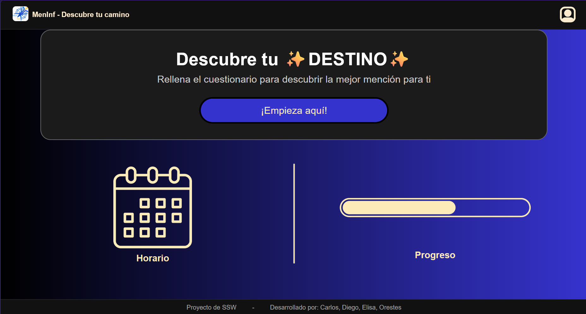
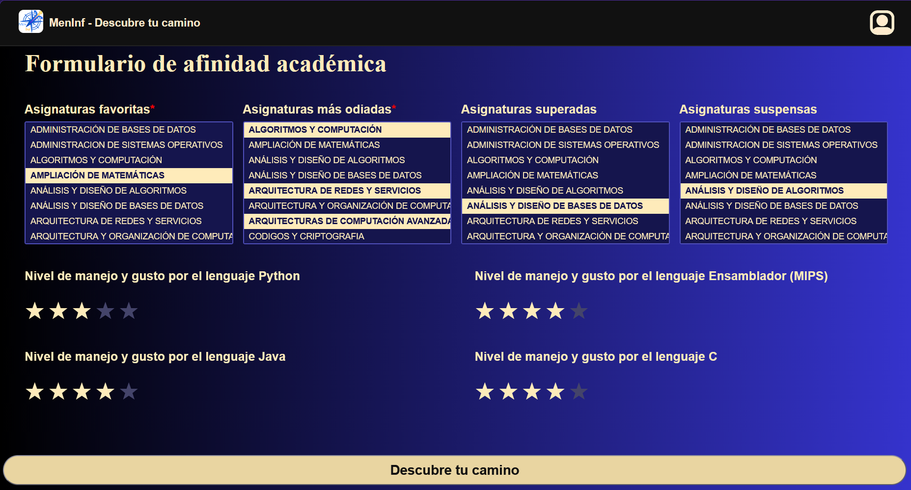
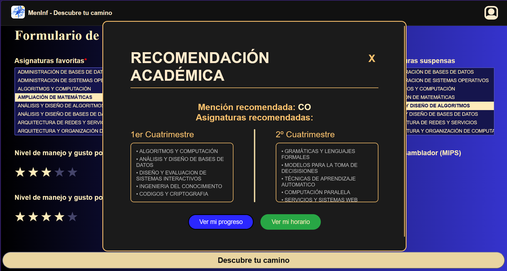
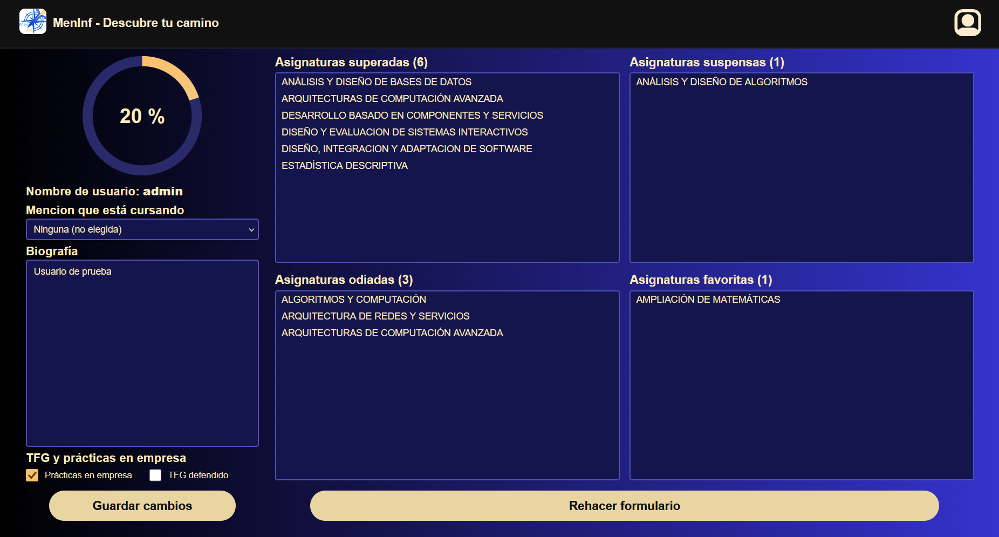
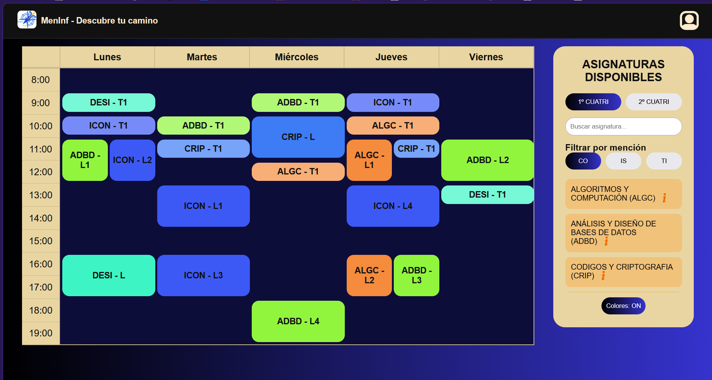
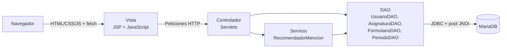

<div align="center">


# MenInf

**Aplicación web que recomienda a los estudiantes del Grado en Ingeniería Informática de la Universidad de Valladolid qué mención cursar y qué optativas elegir, a partir de sus gustos, su expediente y su manejo de los lenguajes de programación.**


</div>

---

## Tabla de contenidos

- [Descripción](#descripción)
- [Funcionalidades](#funcionalidades)
- [Capturas de pantalla](#capturas-de-pantalla)
- [Arquitectura](#arquitectura)
- [Algoritmo de recomendación](#algoritmo-de-recomendación)
- [Tecnologías](#tecnologías)
- [Estructura del proyecto](#estructura-del-proyecto)
- [Instalación y ejecución](#instalación-y-ejecución)
- [Endpoints](#endpoints)
- [Limitaciones conocidas y mejoras futuras](#limitaciones-conocidas-y-mejoras-futuras)
- [Equipo](#equipo)

---

## Descripción

Al llegar a tercer curso, los estudiantes del Grado en Ingeniería Informática de la UVa tienen que elegir entre tres menciones: **Ingeniería de Software (IS)**, **Computación (CO)** y **Tecnologías de la Información (TI)**. También tienen que elegir las optativas de cada cuatrimestre.

MenInf ayuda a tomar esa decisión. El estudiante rellena un formulario de afinidad académica y la aplicación calcula cuál de las tres menciones encaja mejor con él. Además, le propone las asignaturas de cada cuatrimestre de tercero.

Proyecto desarrollado en equipo para la asignatura **Servicios y Sistemas Web (SSW)** de tercer curso, durante el curso 2025-2026.

## Funcionalidades

- **Registro e inicio de sesión** de usuarios, con gestión de sesión en el servidor.
- **Formulario de afinidad académica**: asignaturas favoritas, asignaturas que menos gustan, asignaturas superadas y suspensas, y valoración de 1 a 5 estrellas del manejo y gusto por Python, Java, C y ensamblador MIPS.
- **Recomendación de mención** con la selección de asignaturas propuesta para el primer y el segundo cuatrimestre de tercero.
- **Perfil y progreso**: biografía, mención que se está cursando, TFG y prácticas en empresa, y resumen de asignaturas superadas, suspensas, favoritas y odiadas. El formulario se puede rehacer.
- **Horario**: asignaturas disponibles por cuatrimestre, con filtro por mención y detalle de cada asignatura (periodos, profesorado, lenguajes y prerrequisitos).

## Capturas de pantalla

| Inicio | Formulario de afinidad |
|:---:|:---:|
|  |  |
| **Recomendación** | **Progreso** |
|  |  |
| **Horario** | |
|  | |

## Arquitectura

La aplicación sigue el patrón **Modelo-Vista-Controlador (MVC)**, con una capa de acceso a datos basada en el patrón **DAO**:



- **Vista**: páginas JSP y HTML con JavaScript. Los datos dinámicos se piden al servidor mediante `fetch`.
- **Controlador**: un servlet por cada operación (inicio de sesión, registro, formulario, progreso, asignaturas, etc.).
- **Modelo**: entidades del dominio (`Asignatura`, `Usuario`, `Mencion`, `Profesor`, `Lenguaje`, `Periodo`), relaciones (`Cursada`, `AsignaturaMencion`) y DTO.
- **Acceso a datos**: los DAO obtienen las conexiones de un pool de Tomcat configurado por JNDI (`jdbc/meninf`) y usan `PreparedStatement` en todas las consultas.

## Algoritmo de recomendación

El cálculo se hace en la clase `RecomendadorMencion`, en tres pasos:

1. **Puntuación de cada asignatura.** Se parte de 0 y se suma o resta según los prerrequisitos de la asignatura que el estudiante ha marcado en el formulario:

   | Prerrequisito marcado como | Puntos |
   |---|:---:|
   | Favorito | +3 |
   | Odiado | −3 |
   | Superado | +1 |
   | Suspenso | −1 |

   Además, por cada lenguaje que usa la asignatura se suma `(valoración − 3)`. Un lenguaje con 5 estrellas suma +2 y uno con 1 estrella resta −2. Si el lenguaje no se ha valorado, cuenta como neutro (3).

2. **Selección por mención.** Para cada mención (IS, CO y TI) y cada cuatrimestre de tercero y cuarto, se toman las asignaturas obligatorias. En cada hueco de optativa se elige la candidata con mayor puntuación.

3. **Mención recomendada.** Se suman las puntuaciones de las asignaturas seleccionadas en cada mención. Se recomienda la mención con mayor total, junto con su propuesta de asignaturas para los dos cuatrimestres de tercero.

## Tecnologías

| Capa | Tecnologías |
|---|---|
| Frontend | HTML5, CSS3, JavaScript (Fetch API), JSP |
| Backend | Java 17, Jakarta EE (Servlets), API de JNDI |
| Base de datos | MariaDB, JDBC (`mariadb-java-client`) y pool de conexiones de Tomcat |
| Servidor | Apache Tomcat |
| Build | Maven (empaquetado WAR) |
| Control de versiones | Git (GitLab, migrado a GitHub) |

## Estructura del proyecto

```
MenInf/
├── database/
│   ├── schema.sql             # Creación de tablas
│   └── data.sql               # Datos: asignaturas, menciones, profesores, horarios y usuarios de prueba
├── docs/
│   └── screenshots/           # Capturas usadas en este README
├── src/main/
│   ├── java/com/uva/meninf/
│   │   ├── controlador/       # Servlets (capa de control)
│   │   └── modelo/
│   │       ├── dao/           # Acceso a datos (patrón DAO)
│   │       ├── dto/           # Objetos de transferencia de datos
│   │       ├── entidades/     # Entidades del dominio
│   │       ├── enums/         # MencionTipo, EstadoAsignatura
│   │       ├── relaciones/    # Relaciones N:M (Cursada, AsignaturaMencion)
│   │       └── servicios/     # Lógica de negocio (RecomendadorMencion)
│   └── webapp/
│       ├── js/                # Lógica de cliente
│       ├── img/               # Recursos gráficos
│       ├── META-INF/          # context.xml (pool de conexiones)
│       ├── WEB-INF/           # web.xml
│       ├── index.html
│       ├── formulario.jsp
│       ├── progreso.jsp
│       ├── horario.jsp
│       └── style.css
├── pom.xml
└── README.md
```

## Instalación y ejecución

### Requisitos

- JDK 17 o superior
- Maven 3.8 o superior
- Apache Tomcat 10.1 o superior
- MariaDB

### Pasos

1. **Clona el repositorio**

   ```bash
   git clone https://github.com/Diego-Requejo/MenInf.git
   cd MenInf
   ```

2. **Crea la base de datos y carga los datos**

   ```bash
   mysql -u root -p -e "CREATE DATABASE meninf CHARACTER SET utf8mb4 COLLATE utf8mb4_unicode_ci;"
   mysql -u root -p meninf -e "source database/schema.sql"
   mysql -u root -p meninf -e "source database/data.sql"
   ```

3. **Configura la conexión.** Si tus credenciales de MariaDB no son las de por defecto, edita `username`, `password` y `url` en `src/main/webapp/META-INF/context.xml`.

4. **Compila y genera el WAR**

   ```bash
   mvn clean package
   ```

5. **Despliega en Tomcat.** Copia `target/MenInf.war` en la carpeta `webapps/` de Tomcat e inicia el servidor.

6. **Abre la aplicación** en http://localhost:8080/MenInf/

   Puedes entrar con el usuario de prueba `admin` / `admin`, que se crea en `data.sql`.

> También se puede ejecutar directamente desde NetBeans o IntelliJ IDEA Ultimate configurando un servidor Tomcat local.

## Endpoints

| Endpoint | Descripción |
|---|---|
| `/InicioSesion` | Inicia la sesión del usuario |
| `/RegistrarUsuario` | Registra un nuevo usuario |
| `/CerrarSesion` | Cierra la sesión actual |
| `/ComprobarSesion` | Indica si hay una sesión activa |
| `/DatosFormulario` | Procesa el formulario de afinidad y calcula la recomendación |
| `/GetResultadoJson` | Devuelve el resultado de la recomendación en JSON |
| `/ObtenerProgreso`, `/MostrarProgreso` | Devuelve el progreso académico del usuario |
| `/ActualizarPerfil` | Guarda los cambios del perfil (biografía, mención, TFG y prácticas) |
| `/ListarAsignaturas` | Lista las asignaturas del grado |
| `/ObtenerAsignatura?id=` | Devuelve el detalle de una asignatura |
| `/ObtenerPeriodos?id=` | Devuelve los periodos (horario) de una asignatura |

## Limitaciones conocidas y mejoras futuras

- [ ] **Almacenar las contraseñas con hash** (por ejemplo, BCrypt). Ahora se guardan en texto plano.
- [ ] **Sacar las credenciales de la base de datos** de `context.xml` a variables de entorno.
- [ ] **Unificar la configuración de los servlets**: hoy se mezclan anotaciones `@WebServlet` y entradas en `web.xml`.
- [ ] **Añadir tests unitarios** de `RecomendadorMencion`.
- [ ] **Desplegar una demo pública.**

## Equipo

Proyecto desarrollado por:

- **Carlos Cagigas Villar**
- **Elisa Martínez Lafuente**
- **Orestes Sancho López**
- **Diego Requejo Alonso** · [LinkedIn](https://www.linkedin.com/in/diego-requejo-alonso-662b33396/)

---

<sub>Proyecto académico · Grado en Ingeniería Informática · Universidad de Valladolid</sub>
